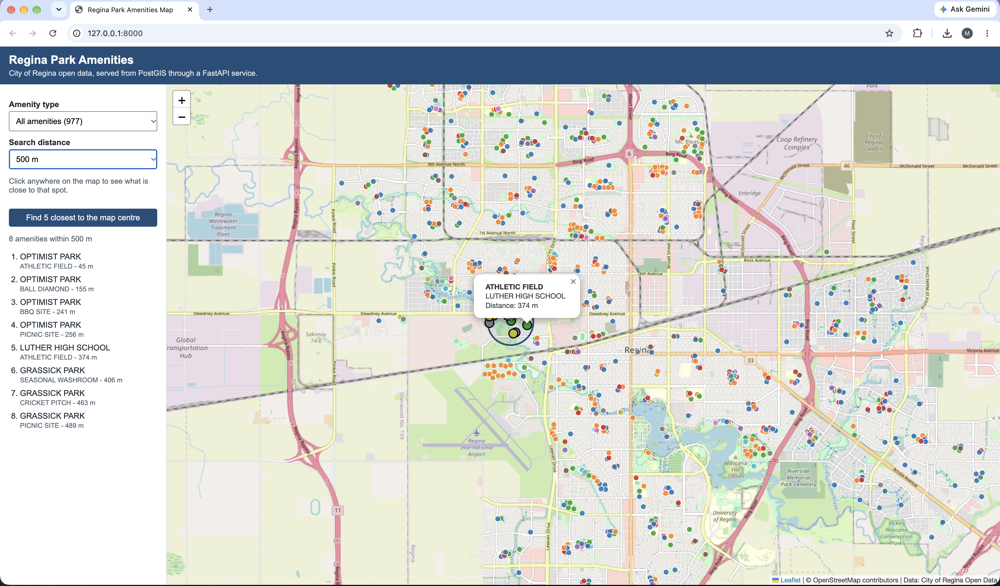

# Regina Park Amenities Map

A small geospatial web app that shows City of Regina park amenities (playgrounds, washrooms, sports fields and more) on a map, and lets you search for what is close to any spot in the city.

I built it to learn the full path of GIS data: from a raw shapefile, into a spatial database, through a REST API, and onto a web map.



## What it does

- Downloads the Park Amenities shapefile from the City of Regina open data portal
- Loads it into PostgreSQL with PostGIS using Python and GDAL (`ogr2ogr`), and reprojects it to WGS 84
- Runs spatial SQL: distance searches, buffers, nearest neighbour and counts by type
- Serves the data as GeoJSON from a FastAPI REST service, with Swagger docs
- Shows everything on a Leaflet web map (HTML, CSS, JavaScript). Click the map to see amenities within 250 m to 2 km
- Can publish the same layer to ArcGIS Online as a hosted feature layer with the ArcGIS API for Python

## Tools

| Area | Tools |
| --- | --- |
| Language | Python, SQL, JavaScript, HTML, CSS |
| Database | PostgreSQL 16, PostGIS |
| GIS | GDAL / ogr2ogr, QGIS (to check the data), ArcGIS Online, ArcGIS API for Python |
| API | FastAPI, Swagger / OpenAPI, psycopg 3 |
| Web map | Leaflet, OpenStreetMap tiles |
| Testing | pytest |

## How it works

```
City of Regina shapefile (.zip)
        |
        |  etl/download_data.py
        v
ogr2ogr (GDAL)  ->  staging table  ->  park_amenities table + spatial indexes
        |               etl/load_data.py, sql/02_indexes.sql
        v
PostgreSQL + PostGIS
        |
        |  api/main.py (FastAPI)
        v
GeoJSON over REST  ->  web/ (Leaflet map)
        |
        +-> arcgis_online/publish_to_arcgis.py  ->  ArcGIS Online hosted feature layer
```

## Project structure

```
api/              FastAPI app (routes, SQL queries, helpers)
arcgis_online/    script to publish the layer to ArcGIS Online
data/             downloaded files go here (not in git)
etl/              download and load scripts, shared settings
sql/              setup, indexes and the spatial queries I tested
tests/            pytest tests for the API and helpers
web/              Leaflet map (index.html, style.css, app.js)
```

## How to run it

### 1. What you need

- Python 3.11 or newer
- PostgreSQL with PostGIS. The easiest way is Docker (`docker-compose.yml` is included). You can also install PostgreSQL and add PostGIS with Stack Builder.
- GDAL for `ogr2ogr`. It comes with QGIS. On Windows, use the OSGeo4W Shell, or set `OGR2OGR_PATH` in `.env` to the full path of `ogr2ogr.exe`.

### 2. Set up Python

```bash
python -m venv .venv
.venv\Scripts\activate        # Windows
source .venv/bin/activate     # Mac / Linux
pip install -r requirements.txt
```

### 3. Settings

Copy `.env.example` to `.env` and set your database password.

### 4. Start the database

With Docker:

```bash
docker compose up -d
```

Without Docker, create an empty database called `regina_gis` in your local PostgreSQL. The load script turns on PostGIS for you.

### 5. Download and load the data

```bash
python -m etl.download_data
python -m etl.load_data
```

The loader prints the columns it found in the shapefile and which ones it used for name, type and park. The portal does not document the column names, so if it picks the wrong ones, set `NAME_COLUMN`, `TYPE_COLUMN` or `PARK_COLUMN` in `.env` and run it again.

### 6. Start the API

```bash
uvicorn api.main:app --reload
```

- Map: http://127.0.0.1:8000/
- Swagger docs: http://127.0.0.1:8000/docs

### 7. Run the tests

```bash
pytest
```

The tests replace the database with fake data, so they run without PostgreSQL.

### 8. Publish to ArcGIS Online (optional)

```bash
pip install -r requirements-arcgis.txt
python -m arcgis_online.publish_to_arcgis
```

Add `ARCGIS_USERNAME` and `ARCGIS_PASSWORD` to `.env` first. A basic public ArcGIS Online account can't publish hosted feature layers, so this needs an organizational account, a trial, or an ArcGIS Location Platform account.

## API endpoints

| Method | Endpoint | What it returns |
| --- | --- | --- |
| GET | `/api/health` | API and database status |
| GET | `/api/amenities/types` | Each amenity type with a count |
| GET | `/api/amenities?type=&bbox=&limit=` | Amenities as GeoJSON, with an optional type filter and bounding box |
| GET | `/api/amenities/near?lat=&lon=&radius_m=&type=` | Amenities within a distance (metres), closest first |
| GET | `/api/amenities/nearest?lat=&lon=&limit=&type=` | The closest amenities to a point |
| GET | `/api/amenities/{id}` | One amenity |

Example:

```
/api/amenities/near?lat=50.4475&lon=-104.6107&radius_m=500
```

## Spatial SQL

`sql/03_spatial_queries.sql` has the queries I used while testing the data:

- amenities within 500 m of a point with `ST_DWithin`
- the 5 closest playgrounds with the `<->` nearest neighbour operator
- a 300 m buffer with `ST_Buffer`
- playgrounds that have a washroom within 150 m
- `EXPLAIN ANALYZE` with and without the spatial index, to compare the query plans

## Notes

- Points are stored in EPSG:4326 (longitude, latitude). For distances I cast to `geography` so the results are in metres, not degrees.
- There is a GiST index on `geom` for bounding box searches, and one on `geom::geography` so `ST_DWithin` and `<->` don't scan the whole table.
- All user input goes into the SQL as parameters, never pasted into the query string.
- The loader uses `ST_PointOnSurface`, so it still works if the source has multipoints.

## Ideas for later

- Add the park boundary polygons and show which park each amenity is in
- Make a second version of the map with OpenLayers
- Try the ArcGIS Maps SDK for JavaScript for the front end
- Deploy it so it can be opened without running it locally

## Data

Park amenities data comes from the [City of Regina Open Data portal](https://open.regina.ca/dataset/parks-and-amenities). Check the portal for the licence terms. Base map tiles are from OpenStreetMap.
